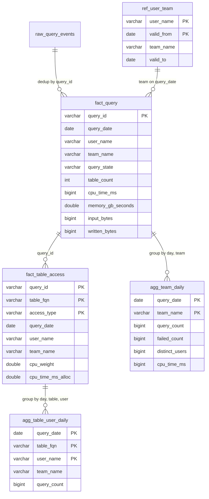

# Design: Trino usage meta DWH

The goal is to answer two questions for any period, with history:

1. How many distinct users used table X?
2. How many resources did team Y use?

The demo runs on DuckDB. The same tables would run on Trino + Iceberg in production.

## Data model

| Table | One row per... | Key |
| --- | --- | --- |
| `raw_query_events` | event as delivered (can have duplicates) | none |
| `ref_user_team` | user x validity period | `user_name, valid_from` |
| `fact_query` | query | `query_id` |
| `fact_table_access` | query x table x access type | `query_id, table_fqn, access_type` |
| `agg_table_user_daily` | day x table x user | `query_date, table_fqn, user_name` |
| `agg_team_daily` | day x team | `query_date, team_name` |

The main idea is that there are **two grains**:

- `fact_query` has one row per query. It is used for resources, so a query that reads 4 tables is not counted 4 times.
- `fact_table_access` has one row per query and table. It is used for "who used table X".

Facts are built from raw. Marts are built only from facts. This means every table can be rebuilt.

### Why `agg_table_user_daily` keeps users and not a number

Distinct counts cannot be added over days (a user who comes on Monday and Tuesday would be counted twice). So the mart keeps one row for each day, table and user. Then Q1 can use `COUNT(DISTINCT user_name)` over any period and the answer is exact. The table stays small because it is only users x tables they use.

## Assumptions

1. One raw row is one Trino `QueryCompletedEvent`. It has `query_id`, `user`, `query_state`, `end_time` (UTC), the statistics, an `inputs` list and an optional `output`.
   In the demo JSON the table fields are called `schema_name` and `table_name`, because `schema` and `table` are SQL words.
2. Events can be duplicated and can come up to 2 days late. Because of this every run rebuilds the last 3 days.
3. A query belongs to the UTC date of its `end_time`.
4. The Trino `user` is the login of the person. The file `data/user_team.csv` maps a user to one team at a time, with history. In production this would be a daily export from the IdP / HR system.
5. A query is given to the team the user had **on the query date**. A team move does not change old data.
6. Service accounts (`svc_*`) are in the same file with the team that owns them. Users that are not in the file get the team `unknown`.
7. A query that reads N tables gives N rows in `fact_table_access`. For "who used X" a user is counted once per table.
8. Team totals come from `fact_query`, so queries with many tables are never counted twice.
9. CPU of a query is split between its tables by the share of input bytes (equal split if all bytes are 0). Writes are saved with `access_type = 'write'` and get no CPU.
10. Failed queries count in the resources, but not in "distinct users".

## Resource metrics

| Column | From event | Why |
| --- | --- | --- |
| `cpu_time_ms` | `cpu_time_ms` | Main cost number. Can be added. |
| `memory_gb_seconds` | `cumulative_memory` / 1e9 | Memory held over time, shows heavy joins. |
| `peak_memory_bytes` | `peak_memory_bytes` | For capacity planning. Cannot be added, use max. |
| `input_bytes` | `physical_input_bytes` | How much was read from storage. |
| `written_bytes` | `written_bytes` | Storage growth. |
| `wall_time_ms` | `wall_time_ms` | How long the user waited, not a cost. |

Allocation rule: `cpu_weight = table input bytes / query input bytes`, and `cpu_time_ms_alloc = query cpu_time_ms * cpu_weight`. A test checks that the allocated CPU of a query adds up to the CPU of the query.

## Update strategy

`python src/pipeline.py --date D` rebuilds the window D-2 ... D:

1. Load the raw JSONL files and `user_team.csv`.
2. `fact_query`: keep the newest event for each `query_id`, join the team as of `query_date`.
3. `fact_table_access`: `UNNEST` the inputs, add the output as a write row, compute the CPU weights.
4. `agg_table_user_daily` and `agg_team_daily`: group the window again.

Every step first deletes the window and then inserts it, so running a day twice gives the same result, and late events are fixed on the next run. `--from` / `--to` runs the same thing for each day (backfill).

The demo reloads all raw files on every run (the table is only 15k rows). In production only new files would be added.

## In production (Trino + Iceberg)

- The same tables, with `partitioning = ARRAY['day(query_date)']`.
- `MERGE` on the keys instead of delete + insert.
- The raw events come from the Trino event listener (for example into a Kafka topic or an Iceberg table).
- The steps run each day in Airflow.

## Cut on purpose (next steps)

| Cut | How it would work in production |
| --- | --- |
| Docker Trino + Iceberg | Same SQL on Trino, partitions and `MERGE` |
| Staging layer | Add views if the raw schema gets messy |
| Surrogate keys and SCD2 dimensions | `ref_user_team` already has dates, make `dim_user` / `dim_team` when needed |
| `dim_table` and "unused tables" report | Join the Iceberg table list with `agg_table_user_daily` |
| Cost in money | A price table (CPU-hour, GB-hour, TB read) with dates |
| HLL sketches | Only if `agg_table_user_daily` gets too big |
| Views and column usage | The event listener also reports views and columns |
| Airflow DAG, data quality checks, table maintenance | Daily DAG, row count checks, Iceberg `optimize` and `expire_snapshots` |

## Questions for the interviewers

- Is a "user" a login or a person?
- Should failed queries count as usage?
